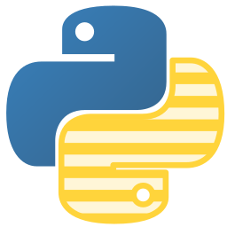

<div align="center">



<br>

[](https://github.com/Opium9Dev/Opcodex/actions/workflows/ci.yml)
[](LICENSE)
[](https://dotnet.microsoft.com/download/dotnet/8.0)
[](#supported-python-versions)
[](#getting-started)
[](https://github.com/Opium9Dev/Opcodex/stargazers)
[](https://github.com/Opium9Dev/Opcodex/issues)
[](https://github.com/Opium9Dev/Opcodex/commits/main)
[](https://github.com/Opium9Dev/Opcodex)

<a href="https://github.com/Opium9Dev/Opcodex">
  
</a>

<br>

[Overview](#overview) &nbsp;|&nbsp;
[Features](#features) &nbsp;|&nbsp;
[Getting started](#getting-started) &nbsp;|&nbsp;
[Workflow](#workflow) &nbsp;|&nbsp;
[Behavior flags](#behavior-flags) &nbsp;|&nbsp;
[Architecture](#architecture) &nbsp;|&nbsp;
[Contributing](#contributing)

</div>

---

## Overview

Opcodex is a desktop workbench for compiled Python. Open a `.pyc` file and you get its code objects, disassembly, recovered pseudo-source, control flow graph and cross-references in a single window. You can edit instructions, assemble new ones, rebuild the file header and marshal stream, and save a patched `.pyc` that the interpreter will load.

Everything is static. Opcodex parses and rewrites bytecode; it never executes the file it is analyzing.

It is built for:

- **Reverse engineers** who need to read or modify bytecode without a matching interpreter installed.
- **Malware analysts** who want a fast triage view of a suspicious `.pyc` before deeper work.
- **Tooling authors and students** who want to see how CPython opcodes, exception tables and line tables fit together across versions.

<div align="center">

| 3.8 to 3.15 | 76 detection rules | 9 correlation chains | 0 code executed |
|:---:|:---:|:---:|:---:|
| one opcode table per CPython release | behavior flags with confidence scores | theft + exfiltration, loader + obfuscation, ... | analysis is purely static |

</div>

## Features

### Inspection

| Capability | Details |
|---|---|
| **Code object tree** | Every nested code object (functions, classes, comprehensions, lambdas) in one navigable tree. |
| **Disassembly** | Offsets, opcodes, operands with resolved names and constants, inline cache entries and jump targets. |
| **Pseudo-source** | A best-effort Python reconstruction of the selected code object, with syntax highlighting. |
| **Control flow graph** | Basic blocks and edges for the selected routine. |
| **Cross-references** | Find every use of a name, constant or jump target. |
| **Data tabs** | Imports, constants, names, strings and the raw file header, each in its own tab. |
| **Search** | Find in view, search across all code objects, go to offset, go to jump target. |
| **Export** | Disassembly to `.txt`, recovered source to `.py`, or copy a single instruction, routine or the whole file. |

### Patching

| Capability | Details |
|---|---|
| **Instruction editing** | NOP an instruction, delete it, or invert a conditional jump. |
| **Inline assembler** | Assemble a new instruction from text. Patches that fit are written in place; others (new constants or names, different instruction size or cache layout) are applied as structural edits. |
| **Undo and redo** | Every edit is tracked in a patch log, with original and patched values side by side. |
| **Rebuild** | Rewrites the header and marshal stream without shared references, and can clear the `check_source` flag on hash-based `.pyc` files so Python does not discard your changes. |
| **Save** | Writes the patched `.pyc` to disk. |

### Triage

| Capability | Details |
|---|---|
| **Behavior flags** | Colored pills under the toolbar summarize what the file appears to do, with the evidence behind each one. |
| **Verdict** | A 0 to 100 risk score with a plain-language level, from "No significant indicators" to "Likely malicious". |
| **Decoded content** | Base64, hex, reversed text, zlib and gzip layers are unpacked up to three levels deep before matching. |
| **Report** | Copy a text report of every flag and its evidence to the clipboard. |

## Supported Python versions

Opcodex ships one generated opcode table per release, built from the CPython sources by `tools/gen_tables.py`.

| CPython | Status |
|:---:|---|
| 3.8, 3.9, 3.10 | Supported |
| 3.11, 3.12, 3.13 | Supported, including inline caches and location tables |
| 3.14 | Supported |
| 3.15 | Tables generated from the CPython `main` branch; may change before release |
| 3.7 and older | Not supported. Opcodex reports the unsupported magic number and stops. |

## Getting started

### Requirements

- Windows 10 or 11, x64
- [.NET 8 SDK](https://dotnet.microsoft.com/download/dotnet/8.0) to build from source

Opcodex is a WPF application, so it runs on Windows only.

### Build and run

```powershell
git clone https://github.com/Opium9Dev/Opcodex.git
cd Opcodex
dotnet run --project Opcodex.csproj -c Release
```

### Publish a standalone executable

`publish.cmd` produces a self-contained, single-file `win-x64` build in `publish\`. It needs no installed runtime.

```powershell
.\publish.cmd
```

> Unsigned, self-contained single-file executables are sometimes flagged by antivirus heuristics. Signing the binary is the most reliable fix. Opcodex also stores its detection signatures base64-encoded so that the scanner's own strings do not trigger static signature matches.

## Workflow

1. **Open** a file with `Ctrl+O`, or from **File > Open .pyc...**. The status bar shows the detected Python version and magic number.
2. **Browse** the code object tree on the left. Select a routine to load its disassembly and pseudo-source.
3. **Investigate** with the Imports, Constants, Names and Strings tabs, the Control flow graph and Cross-references from the **Analysis** menu, and the Flags pills under the toolbar.
4. **Patch** from the context menu or the **Patch** menu: NOP, delete, invert a jump, or assemble a new instruction.
5. **Rebuild** the header and marshal stream, then **save** with `Ctrl+S`.

| Shortcut | Action |
|---|---|
| `Ctrl+O` / `Ctrl+S` | Open a `.pyc` / save the patched file |
| `Ctrl+Z` / `Ctrl+Y` | Undo / redo a patch |
| `Ctrl+N` | NOP the selected instruction |
| `Ctrl+F` | Find in the current view |
| `Enter` / `Shift+Enter` | Next / previous match |
| `Ctrl+G` | Go to offset |
| `Ctrl+C` / `Ctrl+A` | Copy / select all |

## Behavior flags

Opcodex tags each file with behavior flags in the style of an online sandbox report. A flag is a lead to verify in its evidence, not a verdict.

**How a rule works.** Each rule is a list of AND groups, and each group is a list of OR signals. A signal can be an import, a name from `co_names`, a substring or regular expression over string and byte constants, or a high-entropy blob. Extra groups can raise the severity when corroborating signals are present, and a rule can require its signals to sit in the same code object. If they are scattered, the severity is lowered but the hit is kept.

**Severity and confidence.** Every hit is Info, Suspicious or Malicious, with a 0 to 100 confidence that grows with corroboration, decoded evidence and distinct evidence types.

**Correlation chains.** After the rules run, nine chains combine related hits into higher-level findings, for example:

| Chain | Combines |
|---|---|
| Data theft with exfiltration channel | credential or wallet theft with a webhook, bot or file-sharing upload |
| Obfuscated loader | a decode-and-execute loader with packing or obfuscation |
| Downloader that executes what it fetches | a download with process execution, escalating with persistence or evasion |
| Evasion combined with a payload | anti-VM or anti-analysis checks with a loader, injector or stealer |
| Ransomware preparation | mass file encryption with backup destruction or log clearing |

Rule categories include execution and loading, obfuscation and encoding, persistence and privileges, defense evasion, network and command-and-control, credential theft and spyware, and impact. The full table lives in `BuildRules()` in [`Pyc/Flags.cs`](Pyc/Flags.cs).

Flags are computed in a background thread when a file is opened and recomputed after every patch or rebuild.

> Static heuristics produce false positives and false negatives. Treat the result as triage and confirm it by reading the evidence. When handling real samples, work inside an isolated virtual machine.

## Architecture

```text
Opcodex/
|-- Pyc/                      Core library: no UI dependencies
|   |-- PycFile.cs            Header parsing and version detection
|   |-- MarshalReader.cs      Marshal stream -> object model
|   |-- MarshalWriter.cs      Object model -> marshal stream
|   |-- OpcodeTable*.cs       Per-version opcode metadata (generated)
|   |-- Disassembler.cs       Instruction decoding and inline caches
|   |-- LineTables.cs         Line and location table codecs
|   |-- Assembler.cs          Text -> instruction encoding
|   |-- CodeEditor.cs         Instruction edit operations
|   |-- PatchService.cs       Patch planning (in place or structural) and rebuild
|   |-- Stack*.cs             Stack simulation, IR and expression printing
|   |-- Decompiler.cs         Pseudo-source reconstruction
|   |-- Analysis.cs           Control flow graph, cross-references, search
|   `-- Flags.cs              Behavior flag engine
|-- MainWindow*.cs / *.xaml   WPF interface
|-- tools/                    Python helpers (see below)
|-- newlogo/                  Logo and icon assets
`-- .github/workflows/        CI (Windows build on every push and pull request)
```

### Developer tools

| Script | Purpose |
|---|---|
| `tools/gen_tables.py` | Regenerates the opcode tables from CPython sources. Run it with a 3.13 interpreter. |
| `tools/roundtrip.py` | Compiles and compares the observable behavior of original and decompiled sources. |
| `tools/verify_flags.py` | Evaluates the flag rule table against a `.pyc` without rebuilding the application. |
| `tools/proto.py`, `tools/editor.py` | Python prototypes of the 3.12 location-table codec and instruction editor. |

## Limitations

- Windows only, because the interface is WPF.
- Pseudo-source is a best-effort reconstruction. Heavily optimized or hand-patched code may not decompile cleanly; the disassembly is always authoritative.
- Python versions before 3.8 are not supported.
- Behavior flags are heuristics over static content. Encrypted payloads, runtime-generated code and custom packers can evade them.

## Contributing

Issues and pull requests are welcome. For a code change:

1. Fork the repository and create a branch from `main`.
2. Build with `dotnet build Opcodex.csproj -c Release`. CI runs the same command on Windows.
3. Keep changes focused, and describe which CPython versions you tested against.
4. Open a pull request with a short summary and, for new flag rules, a sample that triggers them.

## Repository activity

<div align="center">

<a href="https://github.com/Opium9Dev/Opcodex">
  <picture>
    <source media="(prefers-color-scheme: dark)" srcset="https://github-readme-stats.vercel.app/api/pin/?username=Opium9Dev&repo=Opcodex&theme=tokyonight&hide_border=true">
    
  </picture>
</a>

<br><br>


<br>

<a href="https://star-history.com/Opium9Dev/Opcodex&Date">
  <picture>
    <source media="(prefers-color-scheme: dark)" srcset="https://api.star-history.com/svg?repos=Opium9Dev/Opcodex&type=Date&theme=dark">
    
  </picture>
</a>

</div>

## License

Released under the [MIT License](LICENSE). Copyright (c) 2026 Opcodex contributors.

<div align="center">
<br>

<br>
<sub>Opcodex - read it, patch it, understand it.</sub>
</div>